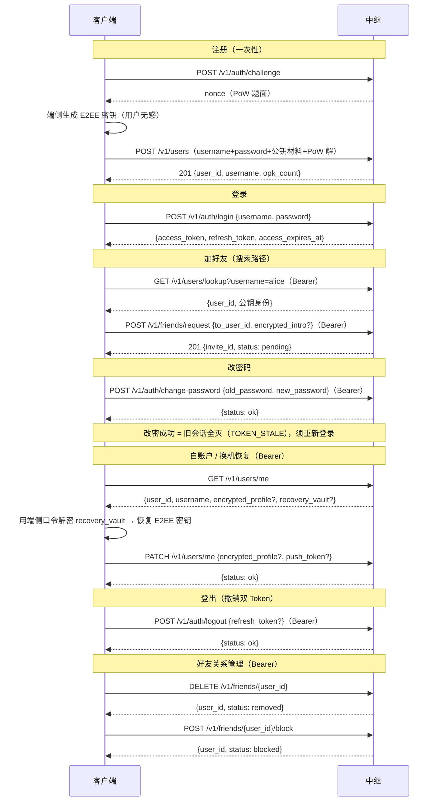

# 用户体系对接文档（客户端 ↔ 中继）

> 面向客户端开发的对接契约。核心设计：**用户只见「用户名 + 密码」**，端到端加密（E2EE）密钥体系完全藏在账号体系背后，用户无感、服务端纯盲。

## 1. 账号模型总览

| 概念 | 说明 | 用户是否可见 |
|---|---|---|
| `username` | 人类可读唯一标识，登录与搜索好友的入口 | 可见 |
| `password` | 仅做登录鉴权；服务端只存 PBKDF2 派生哈希，**零明文落库** | 可见 |
| `user_id` | 服务端生成的 UUID，内部主键（好友关系、信封等以它关联） | 客户端持有但不必向用户展示 |
| `identity_key_pub` 等 E2EE 公钥材料 | X3DH 加密引擎的一部分，端侧生成与持有私钥 | **完全不可见**（藏在注册/换机链路里） |

约束：

- username：小写字母 / 数字 / 下划线，长度 3~32（服务端与 DB 双重校验，唯一）。
- password：最小长度 8；明文仅经 TLS 传输，服务端零明文。

## 2. 全链路时序



## 3. 接口契约

### 3.1 获取 challenge（注册前置）

`POST /v1/auth/challenge` → `200`

```json
{ "nonce": "...", "difficulty": 20 }
```

### 3.2 注册 `POST /v1/users`

请求体（`one_time_prekeys` 首批必须 10~20 个）：

```json
{
  "username": "alice",
  "password": "********",
  "identity_key_pub": "<base64>",
  "signed_prekey_pub": "<base64>",
  "signed_prekey_sig": "<base64>",
  "push_token": "",
  "encrypted_profile": "<base64 端侧密文，可空>",
  "recovery_vault": "<base64 换机恢复金库，可空>",
  "nonce": "<challenge 返回值>",
  "pow_solution": "<Hashcash 解>",
  "one_time_prekeys": [{ "key_id": "...", "pub": "<base64>" }]
}
```

成功 `201`：

```json
{ "user_id": "<UUID>", "username": "alice", "opk_count": 15 }
```

> `user_id` 由服务端生成，客户端不再自报 UUID。公钥材料由客户端自动生成上传，属于加密链路而非用户操作。

### 3.3 登录 `POST /v1/auth/login`

```json
{ "username": "alice", "password": "********" }
```

成功 `200`：

```json
{ "access_token": "...", "refresh_token": "...", "access_expires_at": 1728600000 }
```

后续所有受保护接口带 `Authorization: Bearer <access_token>`；过期用 `POST /v1/auth/refresh`（body `{"refresh_token": "..."}`）换新。

防爆破双防线（客户端需感知）：

- **IP 桶**：单 IP 每分钟登录尝试上限（默认 10，含成功登录），超限 `429 LOGIN_THROTTLED`；
- **账号锁定**：同账号窗口内失败 ≥5 次 → 锁定 15 分钟（期间**正确密码也 429**，`detail.retry_after_sec` 给出等待窗口）；登录成功即清零失败台账。

refresh 换新为**强制轮换**：每次成功换新后旧 `refresh_token` 立即作废，重用旧 token → `401 TOKEN_REVOKED`。客户端必须只保存最新一对。

### 3.4 修改密码 `POST /v1/auth/change-password`（Bearer）

```json
{ "old_password": "********", "new_password": "********" }
```

成功 `200`：`{"status": "ok"}`。只更换密码哈希，**不影响 E2EE 密钥与历史消息**。

**改密即踢会话**：成功后该账号全部既有 `access_token` / `refresh_token` **即时失效**（后续请求 `401 TOKEN_STALE`），所有设备须重新登录。客户端改密成功后应主动清空本地 token 并跳登录页。

### 3.4.1 登出 `POST /v1/auth/logout`（Bearer）

```json
{ "refresh_token": "..." }
```

`refresh_token` 可选（带上则一并撤销）。成功 `200`：`{"status": "ok"}`。当前 `access_token` 与随附的 `refresh_token` 被拉黑至各自自然到期，重复登出幂等无害。客户端登出后应清空本地存储。

### 3.4.2 WSS 连接鉴权 `GET ws(s)://<host>/ws`

- 纯路径建连，**token 绝不进 URL**（反代日志会泄露）；
- 连接后首帧必须是 JSON 文本帧 `{"action":"AUTH","token":"<access_token>"}`，3s 内未完成即被掐线；
- 首帧校验与 REST 同口径：签名/有效期之外，**被登出（jti 拉黑）或改密后（纪元落后）的 access_token 一律拒入**（服务端回 Close 帧后断开）；
- 已建立的连接不会因登出/改密被主动掐断，最长存活一个心跳周期（60s 无 pong 掐线）；客户端收到推送失败或重连时用**最新** token 重新 AUTH。

### 3.5 自账户（读回 / 更新，Bearer）

**读回 `GET /v1/users/me`** → `200`：

```json
{
  "user_id": "<UUID>",
  "username": "alice",
  "encrypted_profile": "<base64，未设置时字段缺省>",
  "recovery_vault": "<base64，未设置时字段缺省>",
  "created_at": 1728600000
}
```

- `recovery_vault` 是**换机恢复链路的取回通道**：新设备登录后拉回端侧加密金库，用端侧口令解密恢复 E2EE 密钥；服务端纯盲不可解。
- `encrypted_profile` 为昵称/备注/头像的端侧密文，客户端解密后展示。

**更新 `PATCH /v1/users/me`**：

```json
{
  "encrypted_profile": "<base64，≤64KB>",
  "recovery_vault": "<base64，≤128KB>",
  "push_token": "<FCM/APNs token，≤4KB>"
}
```

三字段均可选、独立生效：字段缺省 = 不动；`encrypted_profile` / `recovery_vault` present 即整体替换；`push_token` present 空串 = 清空（推送令牌换发时调用，否则 Wake Push 会失效）。成功 `200`：`{"status": "ok"}`。

`recovery_vault` 更新即**金库轮换**：客户端轮换金库包裹钥或修复包裹口径时调用，服务端纯盲只当字节替换。

> **客户端红线**：金库包裹密钥必须独立于登录密码派生——改密只换鉴权哈希，不解密金库；若用登录密码包裹金库，改密后金库将永久无法解密（换机恢复断链）。服务端无法强制此约束，靠客户端自觉。

### 3.6 用户名搜索 `GET /v1/users/lookup?username=alice`（Bearer）

成功 `200`：

```json
{
  "user_id": "<UUID>",
  "username": "alice",
  "identity_key_pub": "<base64>",
  "signed_prekey_pub": "<base64>",
  "signed_prekey_sig": "<base64>"
}
```

查无此人 → `404 USER_NOT_FOUND`。仅登录用户可查（收敛枚举面）。

### 3.7 好友关系（双通道建联 + 关系管理）

- **搜索路径**：`POST /v1/friends/request`（Bearer），body `{"to_user_id": "<UUID>", "encrypted_intro": "<base64，可空>"}`。`encrypted_intro` 是发起方用对端公钥加密的自我介绍，服务端纯盲。
- **扫码路径**：`POST /v1/friends/invite`（Bearer），body 携带 `ticket`（扫码所得）+ `encrypted_intro`。
- **接受/拒绝**：`POST /v1/friends/accept`，body `{"invite_id": "<a:b>", "accept": true|false}`；`invite_id` 形如 `{发起人user_id}:{接收人user_id}`。
- **列表**：`GET /v1/friends`（Bearer）。
- **解除关系**：`DELETE /v1/friends/{user_id}`（Bearer）——删除好友 / 撤回申请 / 解除拉黑三合一，双向命中；双方回到陌生状态，**此后可重新申请**。无关系 → `404 INVITE_NOT_FOUND`。
- **主动拉黑**：`POST /v1/friends/{user_id}/block`（Bearer）——无需既有关系；pending/accepted 一并转 `blocked`。被拉黑方此后**任何方向**的申请都得到与「已存在」相同的 `409 RELATION_EXISTS`（静默，不告知被拉黑事实）。拉黑列表配额 ≤500，超限 `400 EXCEED_BLOCKED_LIST`。

成功申请 `201`：`{"invite_id": "...", "status": "pending"}`。
解除/拉黑成功 `200`：`{"user_id": "...", "status": "removed"|"blocked"}`。

拉黑语义要点：

- blocked 是**持久关系行**：被拉黑方不会因重试而穿透，只能等对方解除拉黑（即上述 DELETE）。
- `GET /v1/friends` 中 blocked 行对双方均可见（status=`blocked`）。

## 4. 错误码（对接必看）

| HTTP | code | 场景 | 客户端处置 |
|---|---|---|---|
| 400 | `USERNAME_INVALID` | 用户名不符 3~32 `[a-z0-9_]` | 前置校验提示 |
| 400 | `PASSWORD_TOO_WEAK` | 密码 < 8 位 | 提示最短长度 |
| 409 | `USERNAME_EXISTS` | 用户名已被占用 | 提示换名 |
| 401 | `USER_OR_PASSWORD_INVALID` | 登录失败（用户不存在/密码错**同一口径**，防枚举） | 统一提示"用户名或密码错误"，勿区分 |
| 401 | `PASSWORD_MISMATCH` | 改密时旧密码错误 | 提示旧密码错误 |
| 401 | `CHALLENGE_INVALID` | nonce 过期/已消费 | 重新取 challenge |
| 429 | `LOGIN_THROTTLED` | 登录 IP 超限 / 账号失败锁定 | 按 `detail.retry_after_sec`（如有）退避重试 |
| 429 | `RATE_LIMITED` | 限流（注册/好友等） | 退避重试 |
| 401 | `TOKEN_REVOKED` | token 已被撤销（refresh 重用 / 登出） | 停用本地该对 token，重新登录 |
| 401 | `TOKEN_STALE` | 改密后旧会话（纪元落后） | 清空本地 token，重新登录 |
| 404 | `USER_NOT_FOUND` | 搜索/申请/拉黑目标不存在 | 提示查无此人 |
| 409 | `RELATION_EXISTS` | 已是好友/已有 pending/被拉黑（同一口径） | 统一提示"关系已存在"，**勿区分**是否被拉黑 |
| 404 | `INVITE_NOT_FOUND` | pending 邀请不存在 / 无此好友关系 | 提示无此邀请或关系 |
| 400 | `EXCEED_BLOCKED_LIST` | 拉黑列表超配额（≤500） | 提示清理拉黑列表 |
| 413 | `ATTACHMENT_OVERSIZE` | `encrypted_profile` 超 64KB | 压缩后重试 |

## 5. 安全边界（对接时不要破坏）

- 密码明文只允许出现在 TLS 通道内的请求体中；服务端日志与错误响应零明文。
- 登录失败不区分"用户不存在"与"密码错误"，客户端 UI 也不得做区分。
- `RELATION_EXISTS` 同理不区分"已是好友"与"被拉黑"，客户端 UI 也不得做区分。
- E2EE 私钥永远只在端侧；换设备走「登录 → `GET /v1/users/me` 取回 `recovery_vault` → 端侧解密恢复」链路，服务端不可解密任何业务数据。
- `access_token` 只存内存、`refresh_token` 存 secure_storage；refresh 换新后旧 token 必须立即丢弃（重用会被判定为盗用而拒绝）。
