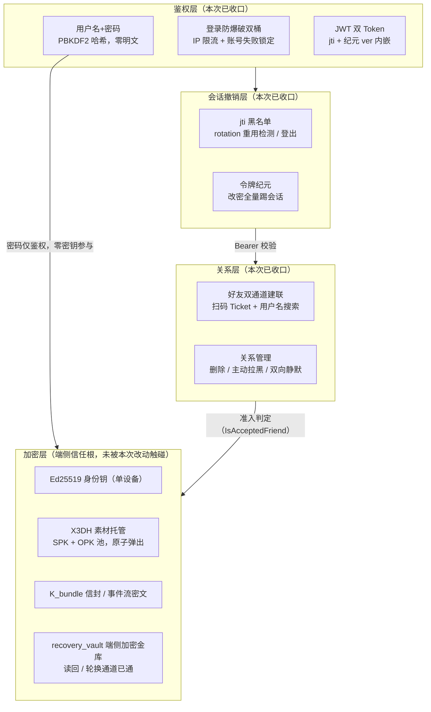

# 用户体系与加密体系：现状盘点与设计债

> 盘点性文档：记录账号/加密两大体系当前的架构现状、已知设计债与待决策项。
> 对接契约见 [api/user-accounts.md](../api/user-accounts.md)；总体方向见 [overview.md](overview.md)。
> 债务清偿时**同轮更新本页**（删条目或移入已收口清单），避免债表过期。

## 1. 分层现状：鉴权与加密的解耦边界

解耦保证：鉴权层任何变化（换 Argon2id、调限流、改会话时长）不触及加密层；
加密层信任根（端侧私钥、X3DH、信封格式）不依赖用户体系任何字段。
改密只 `UPDATE password_hash` + 纪元 Bump——DB 中不存在以登录密码为解密输入的列，**改密不丢数据**。

## 2. 已收口能力（2026-10-11 盘点）

| 能力 | 关键机制 | 代码锚点 |
|---|---|---|
| 注册防滥用 | PoP 自签 + PoW + 单 IP 限流 + OPK 首批瘦身 | `internal/httpapi/register.go` |
| 登录防爆破 | IP 桶（计数所有请求）+ 账号桶（仅计失败，成功清零，达阈值锁定） | `internal/auth/loginguard.go` |
| 会话撤销 | jti 黑名单（rotation 重用即拒 / 登出双 token 拉黑）+ 令牌纪元（改密 O(1) 全量踢） | `internal/auth/denylist.go`、`epoch.go`、`token.go` |
| 自账户 | `GET/PATCH /v1/users/me`：身份读回、密文资料/推送令牌/金库轮换 | `internal/httpapi/me.go` |
| 换机恢复闭环 | 注册写入 → GET me 取回 → 端侧解密 → PATCH 轮换 | 同上 |
| 好友关系对称化 | `DELETE /v1/friends/{id}`（解除三合一）+ `POST .../block`（主动拉黑、双向静默、配额） | `internal/httpapi/friends.go` |
| WSS 同口径 | 首帧 AUTH 查签名 + jti 黑名单 + 纪元，与 REST 一致 | `internal/wss/hub.go` |

## 3. 设计债（按决策紧迫度排序）

### 债① 金库「遗忘即永久丢失」——待产品决策（影响数据格式，宜早定）

- **现状**：`recovery_vault` 由纯客户端口令包裹、服务端盲存。包裹钥独立于登录密码（客户端红线，服务端无法强制）。
- **代价**：用户遗忘恢复口令 → 服务端零辅助能力 → 数据永久丢失。
- **出路**：Signal 式 SVR（HSM 信封 + 用户 PIN，牺牲部分零知识纯度换可恢复性）或接受遗忘即丢失（iMessage 态度）。两者对金库包裹格式的要求不同，**定方向要在用户量上来之前**。
- **已做的对冲**：PATCH 金库轮换端点已就位，客户端包裹格式可平滑升级。

### 债② 多设备 E2EE——结构约束，未解

- **现状**：`users_identity_key_uniq` 唯一约束 = 一账号一把身份钥；手机+平板无法同时解密同一消息流。
- **出路**：per-device 密钥对 + `bundle_members` 信封扇出改造，或共享主钥走既有 `user_key_envelopes` 增量通道。密文格式无需推翻，属增量改造。
- **触发时机**：多端需求实锤时启动，无需提前建设。

### 债③ 首次建联信任锚 = 服务端（TOFU）——已知边界，客户端须给核验入口

- **现状**：搜索路径 lookup 返回的对方公钥无法被客户端独立验证真伪，服务端理论可注入假公钥做静默 MITM。扫码路径有当面核验 + Ticket 验签 + nonce 一次性，较稳；但 issuer 公钥本身亦来自服务端。
- **出路**：短期=引导策略「扫码为主、搜索为辅」+ 客户端提供安全码/指纹核验 UI；长期=密钥透明性日志（Signal 式），成本高，按规模决策。
- **注意**：这是元数据/信任引导问题，不影响已建立会话的密文机密性。

### 次级债（排期项，不紧急）

| 项 | 现状 | 出路 |
|---|---|---|
| identity_key 无轮换路径 | 私钥泄露场景无协议解 | 加 rotation 端点 + 好友重放保护（低频需求） |
| PBKDF2 20 万次 | 低于 OWASP 最新建议 | 迁移 Argon2id；自描述哈希格式已预留平滑升级 |
| 限流器共享配置 | 所有桶实际执行 `RegisterLimitPerMin`（3/min），lookup 等被误伤 | RateLimiter 改 per-bucket 配置 |
| WSS 长连接撤销残余 | 已建立连接不因登出/改密被主动掐断，最长存活 60s 心跳周期 | 读循环周期性复查纪元；当前风险面已很小，待真实需求 |
| 账号注销 | 无端点，FK 级联清理未设计 | 独立需求：软删 + 密文列覆盖擦除方案先行设计 |

## 4. 客户端契约红线（服务端纯盲，无法强制）

1. **recovery_vault 包裹钥必须独立于登录密码派生**——用登录密码包裹金库 = 改密后金库永久解不开。
2. **refresh 换新后旧 token 必须立即丢弃**——重用会被判定为盗用而拒绝（TOKEN_REVOKED）。
3. **`RELATION_EXISTS` 不得区分「已是好友」与「被拉黑」**——防骚扰静默语义，UI 同样不得区分。
4. **token 不进 URL**——WSS 首帧 AUTH 用 JSON 帧，防反代日志泄露。
